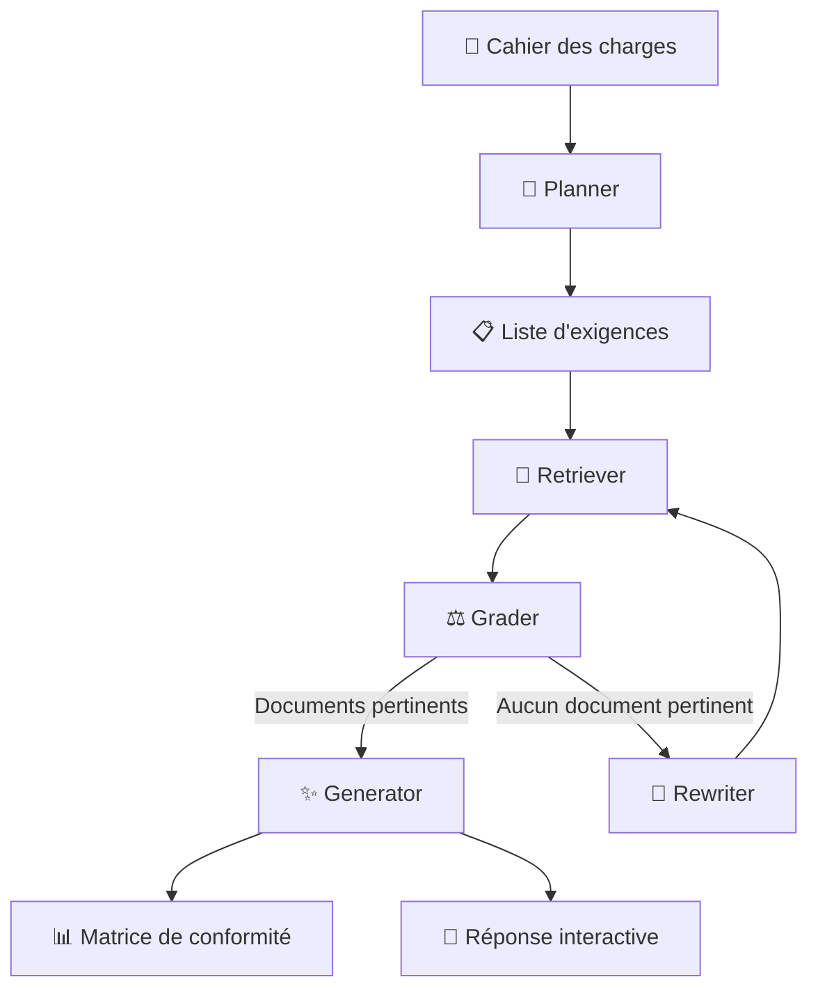

<div align="center">

# NovaFlow Agentique RAG

**Des cahiers des charges deviennent des exigences.**
**Les exigences deviennent des preuves.**


</div>

---

## The Mission

NovaFlow ne se contente pas de répondre à une question avec un modèle de
langage.

Il organise une équipe d'agents spécialisés capable de :

```text
Lire le cahier des charges
        |
        v
Découper les besoins en exigences
        |
        v
Chercher les preuves dans la documentation
        |
        v
Rejeter les documents non pertinents
        |
        v
Produire une matrice de conformité fiable
```

> **Chaque réponse est ancrée dans les documents. Chaque source est traçable.**

---

## Meet the Agent Team

| Agent | Mission | Sortie |
| :--- | :--- | :--- |
| **Planner** | Décompose le cahier des charges | Exigences unitaires |
| **Retriever** | Recherche les passages proches | Chunks ChromaDB |
| **Grader** | Élimine les informations inutiles | Documents pertinents |
| **Rewriter** | Reformule une requête infructueuse | Nouvelle recherche |
| **Generator** | Synthétise les preuves | Statut, réponse, détails |

---

## Agent Workflow



Le comportement est orchestré avec **LangGraph**. Les agents échangent à
travers un état partagé :

```python
{
    "question": "...",
    "search_query": "...",
    "documents": [],
    "generation": "...",
    "retries": 0,
}
```

La boucle de recherche est volontairement limitée :

```python
MAX_RETRIES = 1
```

---

## What You Can Do

### Analyse de cahier des charges

Chargez un fichier TXT, Markdown, PDF ou DOCX.

Le système :

1. extrait le texte ;
2. construit un plan d'exigences ;
3. analyse chaque exigence ;
4. sélectionne les sources ;
5. exporte la matrice.

### Question rapide

Posez une question directement à l'assistant RAG pour interroger la
documentation NovaFlow.

### Matrice de conformité

Chaque ligne contient :

- un identifiant ;
- une catégorie ;
- l'exigence ;
- le statut ;
- la réponse synthétique ;
- les sources consultées.

---

## Project Map

```text
app/
├── agent.py        # Graphe LangGraph
├── planner.py      # Agent de planification
├── state.py        # Mémoire partagée
└── rag/
    └── ingest.py   # Ingestion documentaire

evaluation/
└── eval.py         # Mesure du retrieval

tests/
└── Tests unitaires

streamlit_app.py    # Interface utilisateur
data/pdf/           # Documentation source
chroma_db/          # Mémoire vectorielle
```

---

## Quick Start

```powershell
# 1. Préparer l'environnement
python -m venv .venv
.\\.venv\\Scripts\\Activate.ps1
pip install -r requirements.txt

# 2. Configurer Gemini
Copy-Item env.exemple .env
```

Dans `.env` :

```dotenv
GOOGLE_API_KEY=votre_cle_api
GEMINI_MODEL=gemini-3.1-flash-lite
```

```powershell
# 3. Indexer la documentation
python -m app.rag.ingest

# 4. Lancer NovaFlow
streamlit run streamlit_app.py
```

---

## Watch the Agents Work

Pour observer les mises à jour successives du graphe :

```powershell
python -m app.main
```

Le terminal affiche chaque nœud traversé, les chunks récupérés et la réponse
finale.

---

## Quality Checks

```powershell
# Tests
pytest -v

# Qualité du code
ruff check .
ruff format --check .
```

---

## Evaluation

L'évaluation mesure si les bons documents arrivent jusqu'au générateur :

- rappel du contexte ;
- rappel après le grading ;
- taux de rétention ;
- documents perdus par le grader.

```powershell
python -c "from evaluation.eval import run_retrieval_eval; run_retrieval_eval('evaluation/datasets/eval_dataset.json')"
```

---

<div align="center">

**Built with agents, graphs and grounded answers.**

</div>
